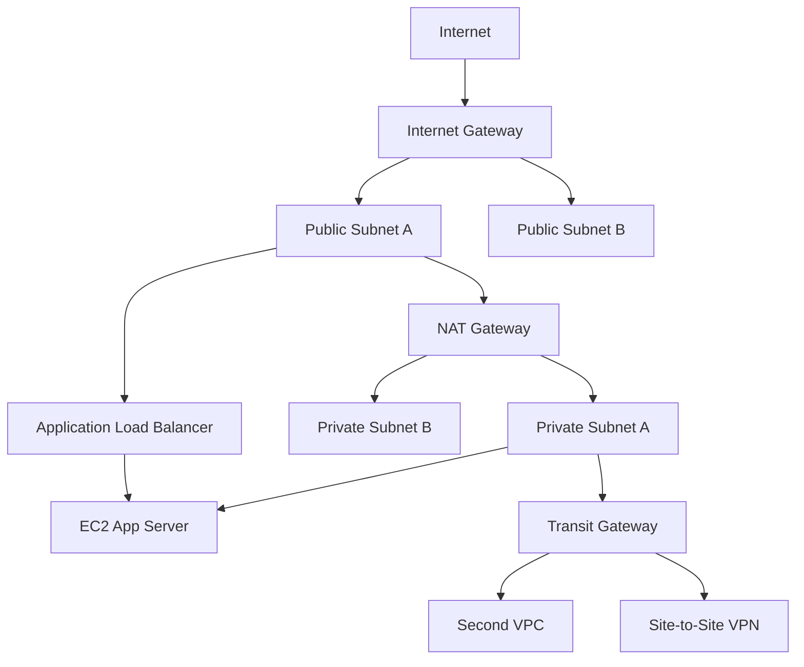

# AWS Cloud Networking

Status - Lab template to be completed. This repo is a hands-on lab plan for learning AWS networking. It is not production experience and it is not a completed project. Work through the labs in a free tier or personal AWS account, watch the spend, take your own screenshots, and update the status line of each lab as you finish it.

## Objective

Build a small AWS network from nothing and learn how the pieces fit together. A VPC with public and private subnets, route tables, an internet gateway, a NAT gateway, security groups, and network ACLs. Then connect VPCs with peering and a transit gateway, add a site-to-site VPN, and finish with a load balancer, Route 53, and flow logs. The goal is to understand cloud networking the way a network engineer thinks about it, as routes, gateways, and filters.

## Architecture



## Technologies used

- Amazon VPC
- EC2
- Internet Gateway and NAT Gateway
- Route tables, security groups, and network ACLs
- VPC Peering and Transit Gateway
- AWS Site-to-Site VPN
- Route 53 and Elastic Load Balancing
- CloudWatch and VPC Flow Logs
- Terraform fundamentals
- AWS CLI

## Lab topology

- VPC on 10.0.0.0/16 in us-east-1
- Public subnet A on 10.0.1.0/24 in us-east-1a
- Public subnet B on 10.0.2.0/24 in us-east-1b
- Private subnet A on 10.0.11.0/24 in us-east-1a
- Private subnet B on 10.0.12.0/24 in us-east-1b
- Second VPC on 10.1.0.0/16 for the peering and transit gateway labs
- On-premises lab network on 192.168.10.0/24 for the VPN lab, with a customer gateway at 203.0.113.10

## Configuration examples

Create the VPC.

```
aws ec2 create-vpc --cidr-block 10.0.0.0/16 --tag-specifications ResourceType=vpc,Tags=[{Key=Name,Value=lab-vpc}]
```

Create the public and private subnets.

```
aws ec2 create-subnet --vpc-id vpc-0123456789abcdef0 --cidr-block 10.0.1.0/24 --availability-zone us-east-1a --tag-specifications ResourceType=subnet,Tags=[{Key=Name,Value=lab-public-a}]
aws ec2 create-subnet --vpc-id vpc-0123456789abcdef0 --cidr-block 10.0.11.0/24 --availability-zone us-east-1a --tag-specifications ResourceType=subnet,Tags=[{Key=Name,Value=lab-private-a}]
```

Create the internet gateway and attach it.

```
aws ec2 create-internet-gateway --tag-specifications ResourceType=internet-gateway,Tags=[{Key=Name,Value=lab-igw}]
aws ec2 attach-internet-gateway --vpc-id vpc-0123456789abcdef0 --internet-gateway-id igw-0123456789abcdef0
```

Create a NAT gateway in a public subnet.

```
aws ec2 allocate-address --domain vpc
aws ec2 create-nat-gateway --subnet-id subnet-0123456789abcdef0 --allocation-id eipalloc-0123456789abcdef0 --tag-specifications ResourceType=natgateway,Tags=[{Key=Name,Value=lab-nat}]
```

Build the public route table and point the default route at the internet gateway.

```
aws ec2 create-route-table --vpc-id vpc-0123456789abcdef0 --tag-specifications ResourceType=route-table,Tags=[{Key=Name,Value=lab-public-rt}]
aws ec2 create-route --route-table-id rtb-0123456789abcdef0 --destination-cidr-block 0.0.0.0/0 --gateway-id igw-0123456789abcdef0
aws ec2 associate-route-table --route-table-id rtb-0123456789abcdef0 --subnet-id subnet-0123456789abcdef0
```

Build the private route table and point the default route at the NAT gateway.

```
aws ec2 create-route-table --vpc-id vpc-0123456789abcdef0 --tag-specifications ResourceType=route-table,Tags=[{Key=Name,Value=lab-private-rt}]
aws ec2 create-route --route-table-id rtb-0123456789abcdef1 --destination-cidr-block 0.0.0.0/0 --nat-gateway-id nat-0123456789abcdef0
```

Create a security group for a web server and open HTTP and SSH.

```
aws ec2 create-security-group --group-name lab-web-sg --description "Lab web server group" --vpc-id vpc-0123456789abcdef0
aws ec2 authorize-security-group-ingress --group-id sg-0123456789abcdef0 --protocol tcp --port 80 --cidr 0.0.0.0/0
aws ec2 authorize-security-group-ingress --group-id sg-0123456789abcdef0 --protocol tcp --port 22 --cidr 203.0.113.5/32
```

Launch an EC2 instance in the private subnet.

```
aws ec2 run-instances --image-id ami-0123456789abcdef0 --instance-type t2.micro --subnet-id subnet-0123456789abcdef0 --security-group-ids sg-0123456789abcdef0 --tag-specifications ResourceType=instance,Tags=[{Key=Name,Value=lab-app}]
```

Create a VPC peering connection and accept it.

```
aws ec2 create-vpc-peering-connection --vpc-id vpc-0123456789abcdef0 --peer-vpc-id vpc-0123456789abcdef1
aws ec2 accept-vpc-peering-connection --vpc-peering-connection-id pcx-0123456789abcdef0
```

Create a transit gateway and attach a VPC to it.

```
aws ec2 create-transit-gateway --description lab-tgw --tag-specifications ResourceType=transit-gateway,Tags=[{Key=Name,Value=lab-tgw}]
aws ec2 create-transit-gateway-vpc-attachment --transit-gateway-id tgw-0123456789abcdef0 --vpc-id vpc-0123456789abcdef0 --subnet-ids subnet-0123456789abcdef0
```

Set up the site-to-site VPN.

```
aws ec2 create-customer-gateway --bgp-asn 65000 --public-ip 203.0.113.10 --type ipsec.1
aws ec2 create-vpn-gateway --type ipsec.1 --tag-specifications ResourceType=vpn-gateway,Tags=[{Key=Name,Value=lab-vgw}]
aws ec2 attach-vpn-gateway --vpn-gateway-id vgw-0123456789abcdef0 --vpc-id vpc-0123456789abcdef0
aws ec2 create-vpn-connection --type ipsec.1 --customer-gateway-id cgw-0123456789abcdef0 --vpn-gateway-id vgw-0123456789abcdef0
```

Create an application load balancer.

```
aws elbv2 create-load-balancer --name lab-alb --subnets subnet-0123456789abcdef0 subnet-0123456789abcdef1 --security-groups sg-0123456789abcdef0 --scheme internet-facing --type application
```

Turn on VPC flow logs to CloudWatch.

```
aws ec2 create-flow-logs --resource-type VPC --resource-ids vpc-0123456789abcdef0 --traffic-type ALL --log-destination-type cloud-watch-logs --log-group-name lab-flow-logs
```

## Terraform lab

The same VPC, written as Terraform. Save it as main.tf and run terraform init, terraform plan, then terraform apply.

```hcl
resource "aws_vpc" "lab" {
  cidr_block           = "10.0.0.0/16"
  enable_dns_hostnames = true
  tags = {
    Name = "lab-vpc"
  }
}

resource "aws_subnet" "public_a" {
  vpc_id            = aws_vpc.lab.id
  cidr_block        = "10.0.1.0/24"
  availability_zone = "us-east-1a"
  tags = {
    Name = "lab-public-a"
  }
}

resource "aws_subnet" "private_a" {
  vpc_id            = aws_vpc.lab.id
  cidr_block        = "10.0.11.0/24"
  availability_zone = "us-east-1a"
  tags = {
    Name = "lab-private-a"
  }
}

resource "aws_internet_gateway" "lab" {
  vpc_id = aws_vpc.lab.id
  tags = {
    Name = "lab-igw"
  }
}

resource "aws_route_table" "public" {
  vpc_id = aws_vpc.lab.id
  route {
    cidr_block = "0.0.0.0/0"
    gateway_id = aws_internet_gateway.lab.id
  }
  tags = {
    Name = "lab-public-rt"
  }
}
```

## Implementation steps

1. Create the VPC and the four subnets
2. Create the internet gateway and the public route table
3. Create the NAT gateway and the private route table
4. Launch an EC2 instance in the private subnet and confirm it can reach the internet through the NAT gateway
5. Create the second VPC and peer the two VPCs, then add the routes on both sides
6. Create the transit gateway, attach both VPCs, and test traffic between them
7. Set up the site-to-site VPN and check the tunnel state
8. Create the load balancer and a Route 53 record for it
9. Turn on flow logs and read one log entry in CloudWatch

## Verification commands

```
aws ec2 describe-vpcs --filters Name=tag:Name,Values=lab-vpc
aws ec2 describe-subnets --filters Name=vpc-id,Values=vpc-0123456789abcdef0
aws ec2 describe-route-tables --filters Name=vpc-id,Values=vpc-0123456789abcdef0
aws ec2 describe-nat-gateways --filter Name=vpc-id,Values=vpc-0123456789abcdef0
aws ec2 describe-vpc-peering-connections
aws ec2 describe-transit-gateways
aws ec2 describe-vpn-connections
aws elbv2 describe-load-balancers --names lab-alb
aws logs filter-log-events --log-group-name lab-flow-logs --limit 5
```

## Troubleshooting scenarios

- A private instance cannot reach the internet, so check the private route table points at the NAT gateway and the NAT gateway is in a public subnet with an Elastic IP
- A public instance has no internet, so check its subnet has a route to the internet gateway and the instance has a public IP
- Peering traffic fails, so check the route tables on both sides and confirm the two VPC CIDRs do not overlap
- The VPN tunnel is down, so check the customer gateway address, the pre-shared key, and the VPN gateway attachment
- The load balancer shows no healthy targets, so check the security group on the targets allows the health check port and the targets are running

## Security best practices

- Keep application servers in private subnets and only the load balancer in public subnets
- Open SSH only to your own address, never to the whole internet
- Use security groups for stateful filtering and network ACLs for a second layer
- Never let two peered VPCs use overlapping CIDR blocks
- Turn on flow logs so you can see what traffic actually moved
- Delete the NAT gateway and the load balancer when the lab is done, since they cost money while they run

## Learning outcomes

- Build a VPC with public and private subnets from the command line
- Route private traffic through a NAT gateway and public traffic through an internet gateway
- Connect VPCs with peering and with a transit gateway
- Build a site-to-site VPN to an on-premises lab network
- Put a load balancer in front of an application and point Route 53 at it
- Read VPC flow logs to prove traffic took the path you expected
- Write the same network as Terraform

## Screenshot placeholders

- screenshots/vpc-console.png - Placeholder, add a screenshot of the VPC console showing the subnets and route tables
- screenshots/flow-logs.png - Placeholder, add a screenshot of a flow log entry in CloudWatch
- screenshots/terraform-plan.png - Placeholder, add a screenshot of the terraform plan output

## Project status

Lab template to be completed. No lab in this repo is finished yet. Update this section as each lab is done.
